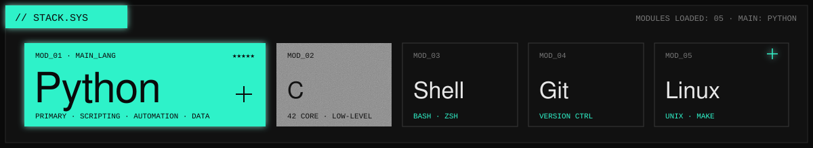

<!-- ═══════════════ HEADER // NEO-BRUTALIST · ACID GRAPHICS ═══════════════ -->

<!-- ═══════════════ TELEMETRY ═══════════════ -->

<!-- ═══════════════ TERMINAL ═══════════════ -->

<!-- ═══════════════ STACK ═══════════════ -->

<!-- ═══════════════ SIGNAL / STATS ═══════════════ -->

<!-- ═══════════════ FOOTER ═══════════════ -->

<code>✦ END_OF_TRANSMISSION ✦ SYS_ONLINE ✦</code>

